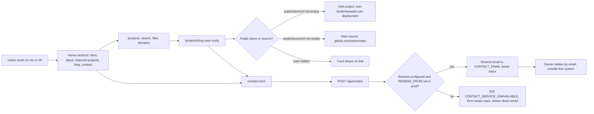
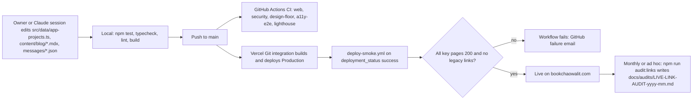
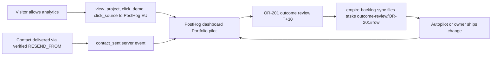

# 01 — Business process (As-Is / To-Be)

Status: **done**. bookchaowalit.com เป็น "root of trust" ของ portfolio (PRODUCT.md "Who this is for"):
ผู้มาเยือน (recruiter, interviewer, ลูกค้า) ตรวจหลักฐานจาก card แล้วติดต่อเจ้าของ
OBJ-01 ใน KPI-PLAN: *a visitor trusts the portfolio enough to get in touch*

## As-Is — ผู้มาเยือนประเมินและติดต่อ (จากโค้ดวันนี้)

Sources: `src/app/[locale]/page.tsx`, `src/components/navigation.tsx`, `src/components/projects-client.tsx`,
`src/app/[locale]/projects/[slug]/project-detail-client.tsx`, `src/data/app-projects.ts` (`publicDemoUrl`, `publicSourceUrl`),
`src/components/contact-client.tsx`, `src/app/api/contact/route.ts`, `PRODUCT.md`, `docs/measurement/KPI-PLAN.md`

## As-Is — เจ้าของอัปเดต catalog / เนื้อหา

Sources: `.github/workflows/ci.yml`, `.github/workflows/deploy-smoke.yml`, `scripts/deploy-smoke.sh`,
`scripts/live-link-audit.mjs`, `docs/measurement/KPI-PLAN.md` (KPI-G-01 cadence "each deploy + monthly"), `specs/001-truthful-portfolio/spec.md` §6

## As-Is — Autopilot loop (AI maker → reviewer → PR → owner approve)

```mermaid
flowchart LR
  C["cron 18:20 and 21:20 UTC, only if AUTOPILOT_ENABLED"] --> Q["Count free Vercel deploys"]
  Q --> M["Merge PRs labelled autopilot:approved if quota > 20 and CI green"]
  M --> PK["Pick autopilot:todo issue by P0..P3"]
  PK --> MK["Maker Claude edits branch autopilot/N-..."]
  MK --> G1["Gate: npm test, typecheck, lint, build"]
  G1 --> G2["Gate: read-only reviewer Claude"]
  G2 --> G3["Gate: visual 375/768/1440 when UI paths change"]
  G3 -- "fail, max 3 attempts" --> MK
  G3 -- "pass" --> PR["Open PR, label needs-human, Telegram"]
  PR --> H["Owner adds autopilot:approved"]
  H --> C
```

Sources: `.github/workflows/autopilot.yml`, `.autopilot/README.md`, `.autopilot/config.json`

## To-Be (มีเอกสารรองรับเท่านั้น)

| # | To-Be | แหล่งที่มา |
|---|---|---|
| 1 | production ส่ง contact ได้จริง: verify `bookchaowalit.com` ใน Resend แล้วตั้ง `RESEND_FROM` | `PRODUCT.md` "What I'd improve next" #2, `RESEND-DOMAIN-SETUP.md`, KPI-PLAN A-4 |
| 2 | วัดผล loop: dashboard "Portfolio pilot" ใน PostHog → baseline → OR-201 (due 2026-11-25) → backlog task | `docs/measurement/GO-LIVE.md` step 6–8, `docs/measurement/OUTCOME-REVIEW-001.md` |
| 3 | แยก vendor chunk 534 kB ให้ละเอียดขึ้น | `PRODUCT.md` "What I'd improve next" #1 |
| 4 | วัด Lighthouse เป็นตัวเลข | `PRODUCT.md` #4–5 |

Sources: `docs/measurement/KPI-PLAN.md`, `docs/measurement/GO-LIVE.md`, `docs/measurement/OUTCOME-REVIEW-001.md`, `analytics/posthog/dashboard.json`

## Open questions

- ไม่มี To-Be ระดับ business process อื่นใน `specs/` หรือ issues ที่อ่านได้ (ไม่มี `docs/UPGRADE-PLAN.md`) — เจ้าของต้องการ flow แบบ lead → proposal ต่อจาก contact หรือไม่
- `RESEND_FROM` ใน Vercel production ตั้งแล้วหรือยัง (เอกสารล่าสุด 2026-10-23 ยังเป็น owner action A-4)
