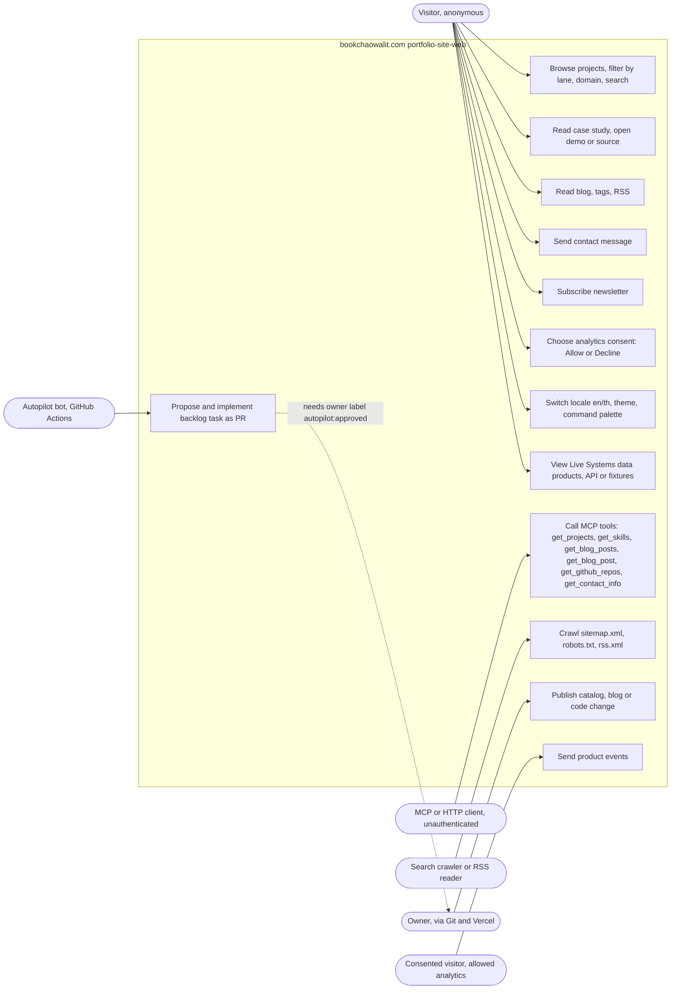

# 02 — Use cases

Status: **done**. เว็บไม่มี sign-in เลย (`src/lib/browser-analytics.ts`: "The portfolio has no sign-in today")
ดังนั้น actor แบ่งตามช่องทางและระดับ consent ไม่ใช่ role ใน auth

Sources: `src/i18n/routing.ts` (pathnames), `src/app/api/*/route.ts`, `src/lib/mcp/tools/index.ts`, `src/app/api/mcp/route.ts`,
`src/components/analytics/analytics-provider.tsx`, `src/components/command-palette.tsx`, `src/components/blog-client-wrapper.tsx`,
`src/components/live-systems-client.tsx`, `src/app/sitemap.ts`, `src/app/robots.ts`, `src/app/rss.xml/route.ts`, `.autopilot/README.md`

## Actor ↔ access level

| Actor | ช่องทาง | Auth | หลักฐาน |
|---|---|---|---|
| Visitor | browser, ทุกหน้า `[locale]` และ `/api/contact`, `/api/newsletter`, `/api/search`, `/api/github-stars`, `/api/screenshot` | ไม่มี | ไม่มี middleware auth; `middleware.ts` ทำแค่ next-intl |
| Consented visitor | เหมือน Visitor + PostHog SDK โหลดหลัง "Allow analytics" | ไม่มี (anonymous id ใน localStorage) | `src/lib/browser-analytics.ts` `CONSENT_KEY` |
| MCP client | `GET/POST /api/mcp`, CORS `*` | ไม่มี | `next.config.js` headers, `src/app/api/mcp/route.ts` |
| Crawler | `/sitemap.xml`, `/robots.txt` (disallow `/api/`), RSS 4 ตัว | ไม่มี | `src/app/robots.ts` |
| Owner | GitHub push to `main` (admin bypass), Vercel env vars | GitHub/Vercel account | `.autopilot/README.md` "Branch protection" |
| Autopilot bot | `GITHUB_TOKEN`, ใส่ label, เปิด PR, dispatch `ci.yml` | GitHub Actions token | `.github/workflows/autopilot.yml` permissions |

## Open questions

- `/api/mcp` เปิด public ไม่มี auth และ CORS `*` โดยตั้งใจ (DevHub Playground เรียก) — ยืนยันว่าเป็น public read-only API ถาวรหรือไม่
