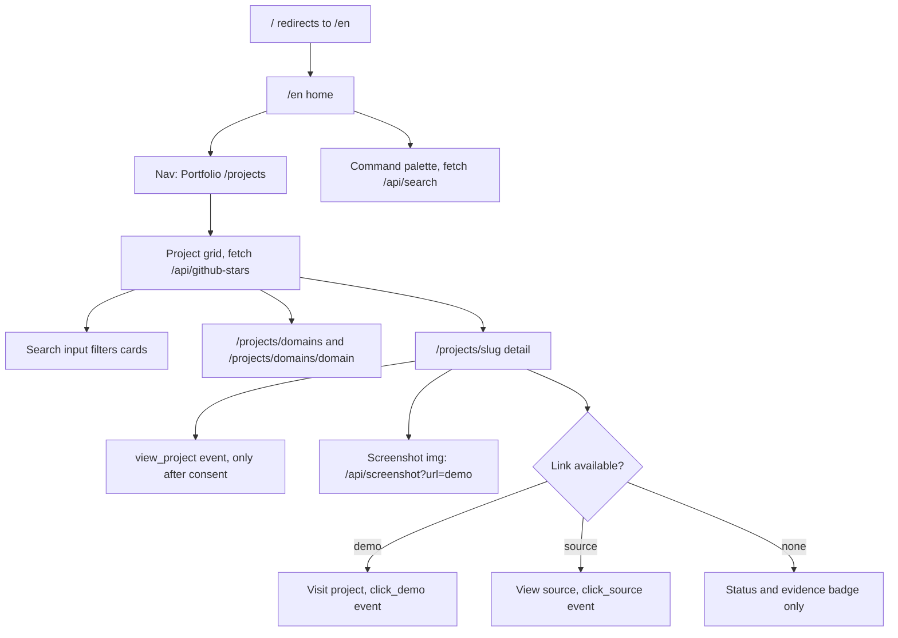
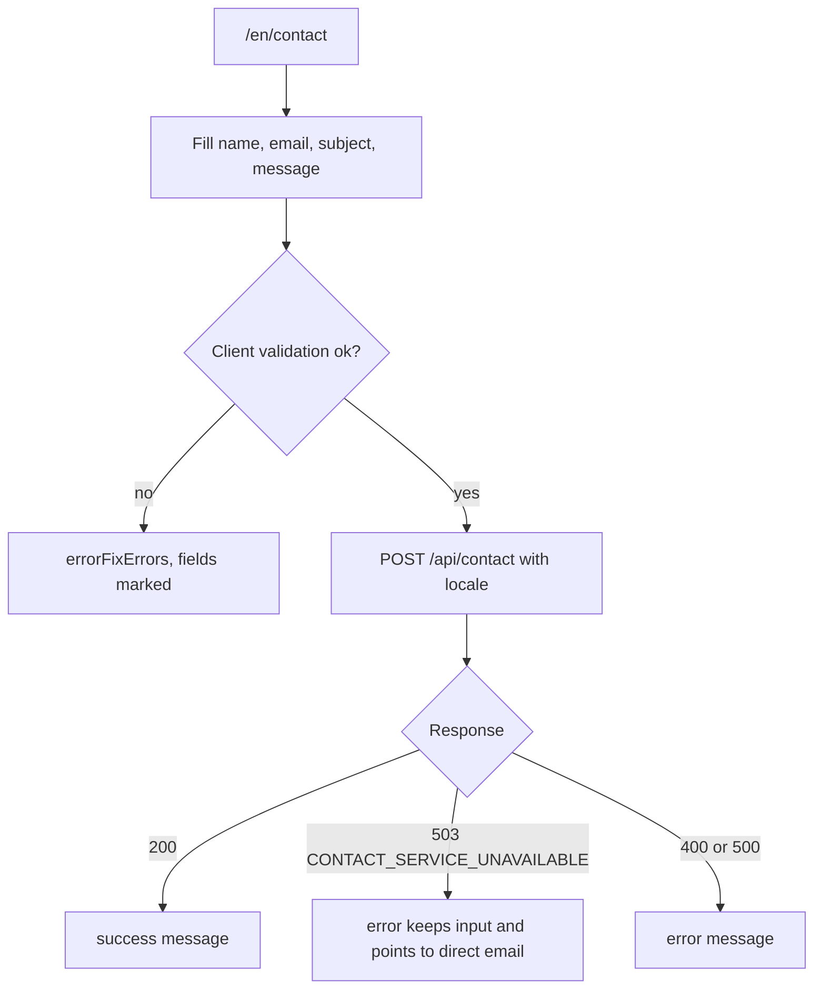
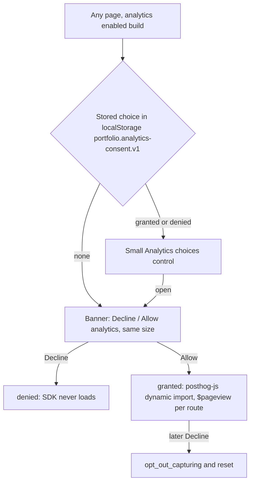
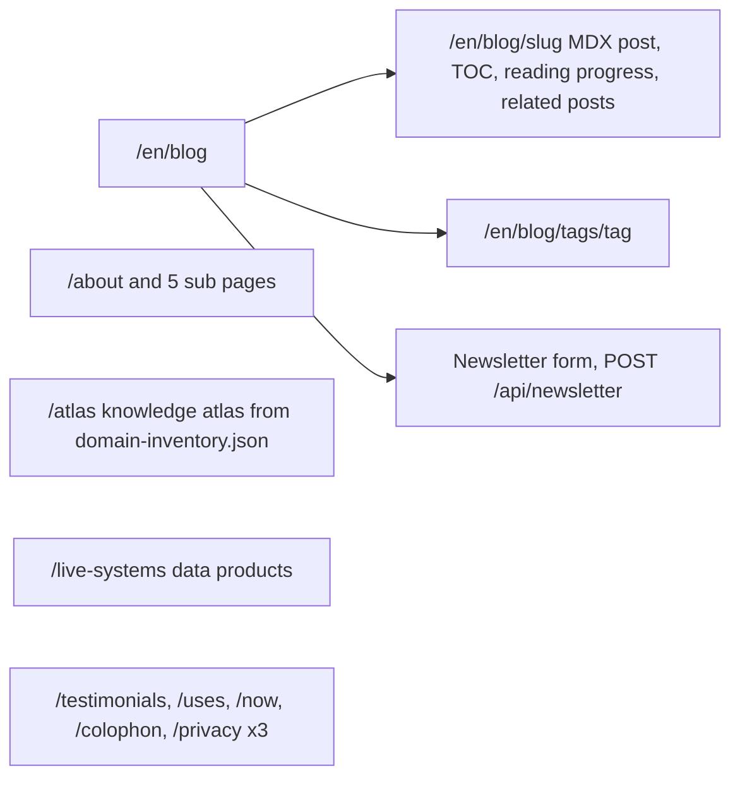
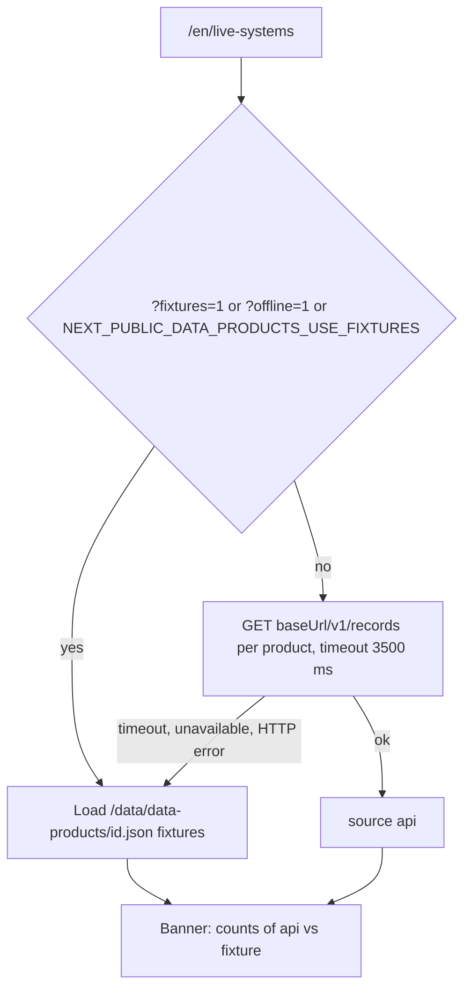
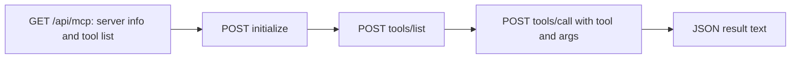

# 03 — User flows

Status: **done**. Route ทั้งหมดอยู่ใต้ `/[locale]` (`en` | `th`, default `en`) จาก `src/i18n/routing.ts`;
path ที่ไม่มี locale ถูก redirect ไป `/en/...` (`next.config.js` `redirects()`), `/` → `/en` (`src/app/page.tsx`)

## Flow 1 — Visitor: ตรวจหลักฐานของ project

Sources: `src/i18n/routing.ts`, `next.config.js`, `src/components/projects-client.tsx`, `src/components/command-palette.tsx`,
`src/app/[locale]/projects/[slug]/project-detail-client.tsx`, `e2e/pages.spec.ts`

## Flow 2 — Visitor: ส่ง contact

Sources: `src/components/contact-client.tsx`, `src/app/api/contact/route.ts`, `e2e/pages.spec.ts` (Contact Page)

## Flow 3 — Visitor: consent banner

Sources: `src/components/analytics/analytics-provider.tsx`, `src/components/analytics/consent-banner.tsx`, `src/lib/browser-analytics.ts`, `src/lib/posthog-adapter.ts`

## Flow 4 — Visitor: blog, newsletter, อื่น ๆ

Sources: `src/app/[locale]/blog/**`, `src/components/blog-client-wrapper.tsx`, `src/app/[locale]/atlas/page.tsx`, `src/i18n/routing.ts`

## Flow 5 — Visitor: Live Systems

Sources: `src/components/live-systems-client.tsx`, `src/lib/data-products/client.ts`, `src/lib/data-products/catalog.ts`, `e2e/data-products-walkthrough.spec.ts`

## Flow 6 — MCP client

Sources: `src/app/api/mcp/route.ts`, `MCP-README.md`

## Flow 7 — Owner: release

ดู [01-business-process.md](01-business-process.md) และ [18-git-release-workflow.md](18-git-release-workflow.md)

## Open questions

- `/live-systems` บน production: ถ้าไม่ได้ตั้ง `NEXT_PUBLIC_DATA_PRODUCT_URL_*` browser ของผู้มาเยือนจะยิงไป `127.0.0.1:8101–8110` ของเครื่องตัวเองแล้ว fallback เป็น fixture — ตั้งใจหรือไม่ และตั้งค่าใน Vercel ไว้หรือยัง
- `NewsletterCTA` (`src/components/lazy/newsletter-cta.tsx`) ไม่มีที่ import — ใช้อยู่ที่ blog page ผ่าน `blog-client-wrapper.tsx` เท่านั้น
