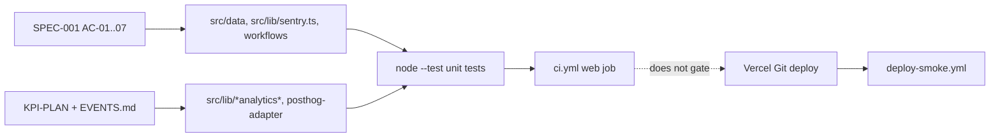

# 04 — Traceability (RTM)

Status: **done**. Requirement มาจาก `specs/001-truthful-portfolio/spec.md` (AC-01…AC-07, NFR) และ
`docs/measurement/KPI-PLAN.md` / `EVENTS.md` (KPI events). Release column = workflow ที่พิสูจน์ใน CI/CD

| Req | Requirement | Code module | Test file | Release / workflow |
|---|---|---|---|---|
| SPEC-001 AC-01 | Source link มาจาก `owner/repo`, `gh()` ปฏิเสธ bare slug | `src/data/app-projects.ts` (`gh`, `allProjects`) | `src/data/__tests__/source-links.test.ts` | `ci.yml` → `web` (`npm test`) |
| SPEC-001 AC-02 | Canonical twins / devtools-suite | `src/data/app-projects.ts` | `src/data/__tests__/source-links.test.ts` | `ci.yml` → `web` |
| SPEC-001 AC-03 | Hidden source/demo ไม่หลุดไป UI, JSON-LD, MCP, screenshot allowlist | `src/data/app-projects.ts` (`publicSourceUrl`, `publicDemoUrl`), `src/lib/mcp/tools/get-projects.ts`, `src/app/api/screenshot/route.ts` | `src/data/__tests__/portfolio-catalog.test.ts`, `source-links.test.ts` | `ci.yml` → `web` |
| SPEC-001 AC-04 | Card ไม่ overclaim | `src/data/app-projects.ts` | `portfolio-catalog.test.ts` ("portfolio claims") | `ci.yml` → `web`; evidence `docs/audits/CARD-CLAIMS-REVIEW-2026-10.md` |
| SPEC-001 AC-05 | Stars match `owner/repo`, นับ repo ซ้ำครั้งเดียว | `src/data/project-stars.ts`, `src/app/api/github-stars/route.ts` | `src/data/__tests__/project-stars.test.ts` | `ci.yml` → `web` |
| SPEC-001 AC-06 | Sentry errors only, scrub PII | `src/lib/sentry.ts`, `sentry.*.config.ts`, `instrumentation-client.ts` | `src/lib/__tests__/sentry.test.ts` | `ci.yml` → `web` |
| SPEC-001 AC-07 | Shared CI v1.1.1 + deploy smoke | `.github/workflows/ci.yml`, `deploy-smoke.yml`, `scripts/deploy-smoke.sh` | GitHub Actions runs | `deploy-smoke.yml` on `deployment_status` |
| SPEC-001 NFR Honesty | 0 broken published links | `scripts/live-link-audit.mjs` | — (script, not test) | manual `npm run audit:links`; `docs/audits/LIVE-LINK-AUDIT-2026-10.md` |
| SPEC-001 NFR Supply chain | OSV clean except reviewed exceptions | `osv-scanner.toml` | — | `ci.yml` → `security` |
| KPI-O-01 | `contact_sent` server event, no PII | `src/lib/server-analytics.ts`, `src/app/api/contact/route.ts` | `src/lib/__tests__/server-analytics.test.ts` | `ci.yml` → `web` |
| KPI-L-01 | `$pageview`, `view_project` after consent | `src/components/analytics/analytics-provider.tsx`, `project-detail-client.tsx`, `src/lib/browser-analytics.ts` | `browser-analytics.test.ts`, `posthog-adapter.test.ts` | `ci.yml` → `web` |
| KPI-L-02 | `click_demo`, `click_source` | `src/app/[locale]/projects/[slug]/project-detail-client.tsx` | `browser-analytics.test.ts` | `ci.yml` → `web` |
| EVENTS catalog | Code ส่งได้เฉพาะ event ใน `EVENTS.md` | `src/lib/browser-analytics.ts` `BROWSER_EVENTS`, `server-analytics.ts` `SERVER_EVENTS` | `src/lib/__tests__/event-catalog.test.ts` | `ci.yml` → `web` |
| ADR-0005 (arch-docs) | GA4 removed, PostHog pinned | `package.json` | `src/lib/__tests__/no-ga4.test.ts` | `ci.yml` → `web` |
| ADR-0005 D-5 PDPA | Consent banner equal buttons, 44px | `src/components/analytics/consent-banner.tsx` | `src/lib/__tests__/consent-banner.test.ts` | `ci.yml` → `web`, `design-floor` |
| ADR-0007 (arch-docs) | Design floor, fonts on `<html>` | `src/app/[locale]/layout.tsx`, `src/app/design-floor/*` | `src/lib/__tests__/font-variables.test.ts` | `ci.yml` → `design-floor` |
| Data-product v4 contract | GET-only, frozen ports, fixture fallback | `src/lib/data-products/*` | `src/lib/data-products/__tests__/client.contract.test.ts`, `contract.freeze.test.ts`, `e2e/data-products-walkthrough.spec.ts` | `ci.yml` → `web` (unit); e2e manual (`npm run e2e:data-products`) |
| A11y (README WCAG table) | skip link, nav labels, keyboard help, axe | layout, navigation, help-dialog | `e2e/home.spec.ts`, `navigation.spec.ts`, `keyboard-help.spec.ts`, `locale-theme.spec.ts`, `a11y-axe.spec.ts` | `ci.yml` → `a11y-e2e`, `lighthouse` |

Sources: `specs/001-truthful-portfolio/spec.md`, `docs/measurement/KPI-PLAN.md`, `docs/measurement/EVENTS.md`, `package.json` (`test` scripts), `.github/workflows/ci.yml`, ไฟล์ test ในตาราง

## Gaps

- `e2e/visual-regression.spec.ts`, `e2e/data-products-walkthrough.spec.ts`, `e2e/pages.spec.ts` ไม่อยู่ใน CI (`ci.yml` รันแค่ `e2e:a11y` + `test:a11y`)
- `/api/contact` validation, `/api/newsletter`, `/api/mcp`, `/api/screenshot` allowlist ไม่มี unit test ตรง ๆ
- `scripts/live-link-audit.mjs` ไม่มีตารางเวลาใน workflow — รันมือ

## Open questions

- requirement ของ blog, testimonials, atlas, newsletter ไม่มี spec — ต้องการ spec ย้อนหลังหรือไม่
