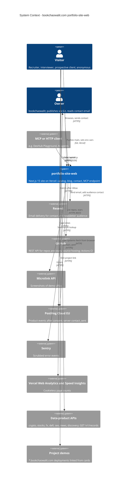

# 05 — C4 Context

Status: **done**

Sources: `src/app/api/contact/route.ts`, `src/app/api/newsletter/route.ts`, `src/app/api/github/route.ts`, `src/app/api/github-stars/route.ts`,
`src/app/api/screenshot/route.ts`, `src/app/api/mcp/route.ts`, `src/lib/server-analytics.ts`, `src/lib/posthog-adapter.ts`, `src/lib/sentry.ts`,
`src/app/layout.tsx` (`@vercel/analytics`, `@vercel/speed-insights`), `src/lib/data-products/catalog.ts`, `src/data/app-projects.ts`, `next.config.js` (CORS comment on DevHub)

## Open questions

- Data-product APIs มี hosted URL สำหรับ production หรือเป็น loopback เท่านั้น (ดู [03-user-flows.md](03-user-flows.md))
