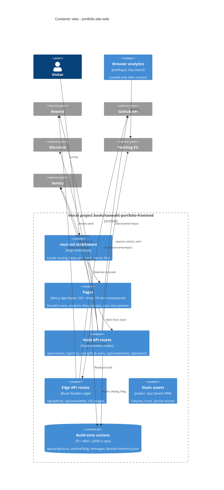

# 06 — C4 Container

Status: **done**. ทั้งหมดเป็น Next.js app เดียว deploy เป็น Vercel project `bookchaowalit-portfolio-frontend`
แยก container ตาม runtime ที่โค้ดประกาศ (`export const runtime`)

Sources: `middleware.ts`, `src/app/api/*/route.ts` (`runtime` exports), `src/app/sw.ts`, `next.config.js` (Serwist, Sentry wrapper),
`src/lib/blog.ts`, `src/data/app-projects.ts`, `src/instrumentation.ts`, `instrumentation-client.ts`, `.autopilot/README.md` (Vercel project name)

หมายเหตุ: `/api/contact`, `/api/github-stars`, `/api/screenshot`, `/api/search` ไม่ได้ประกาศ `runtime` จึงใช้ค่า default ของ Next.js (Node.js);
`/api/mcp` ประกาศ `nodejs` เอง
