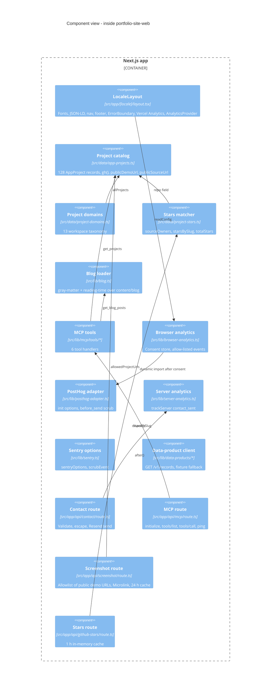

# 07 — C4 Component

Status: **done**. Component ภายใน Next.js app (container "Pages" + "API routes")

Sources: ไฟล์ที่ระบุในแต่ละ component, `src/lib/mcp/tools/index.ts`, `src/data/__tests__/portfolio-catalog.test.ts` (128 records)
