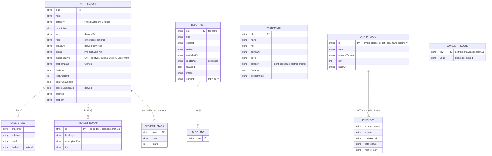

# 09 — ERD (file-backed content model)

Status: **done**. ไม่มี database ([ADR-0003](08-adr/ADR-0003-file-based-content-no-database.md))
แต่มีข้อมูลที่เก็บถาวรใน repo (TS/MDX/JSON) และใน browser (localStorage) จึงวาด model ของข้อมูลเหล่านั้น
ความสัมพันธ์เป็น logical (อ้างด้วยค่า) ไม่ใช่ foreign key

Sources: `src/data/app-projects.ts` (`AppProject`, `CaseStudy`, `ProjectDomain`), `src/data/project-domains.ts`, `src/data/project-stars.ts`,
`src/lib/blog.ts` (`BlogPost`), `src/data/testimonials.ts`, `src/lib/data-products/types.ts`, `src/lib/data-products/catalog.ts`,
`public/data/data-products/*.json`, `src/lib/browser-analytics.ts` (`CONSENT_KEY`)

## ขนาดข้อมูล (นับจากโค้ด)

| Store | จำนวน | วิธีนับ |
|---|---|---|
| `APP_PROJECT` | 128 (live 122, archived 6, wip 0) | `src/data/__tests__/portfolio-catalog.test.ts` |
| evidenceLevel | Prototype 92, Live 24, Experiment 10, Internal System 2 | `grep -o 'evidenceLevel: [^,]*' src/data/app-projects.ts \| sort \| uniq -c` |
| `BLOG_POST` | 6 | `ls content/blog/*.mdx` |
| `DATA_PRODUCT` | 7 | `src/lib/data-products/catalog.ts` |

## Open questions

- `PRODUCT.md` และ `docs/audits/LIVE-LINK-AUDIT-2026-10.md` ยังเขียน 129 cards ขณะที่ test ยืนยัน 128 (url-shortener รวมเข้า redirect-manager 2026-10-23) — ควรอัปเดตเอกสาร
- `ProjectStatus` มี `wip` แต่ไม่มี record ใช้ — จะคงไว้หรือไม่
