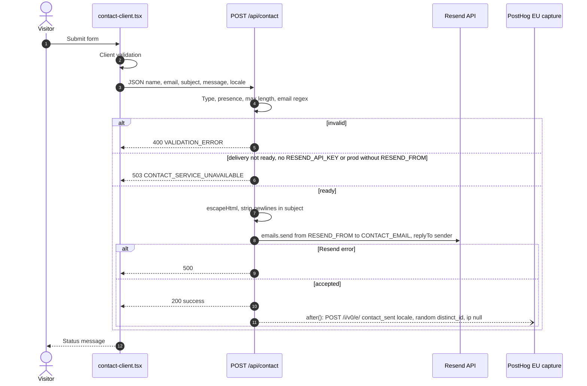
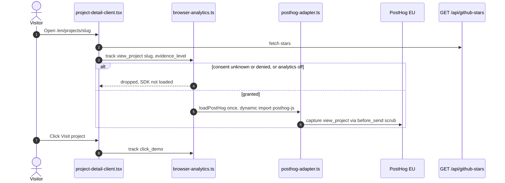
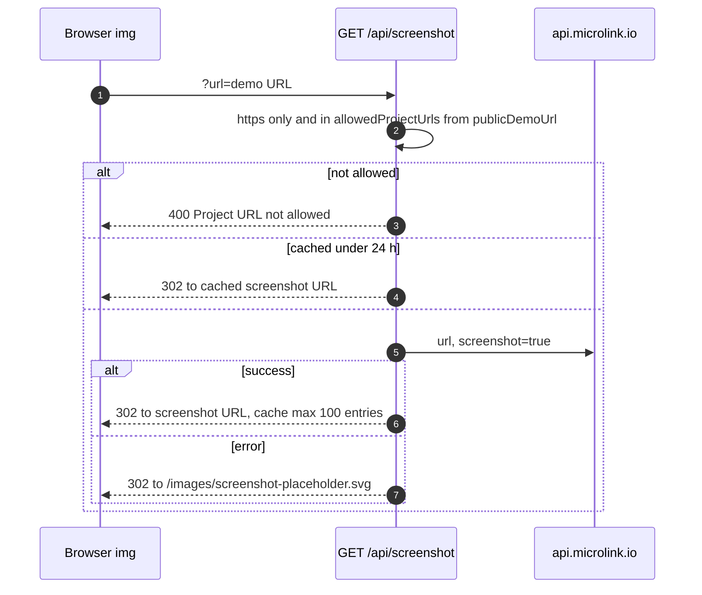
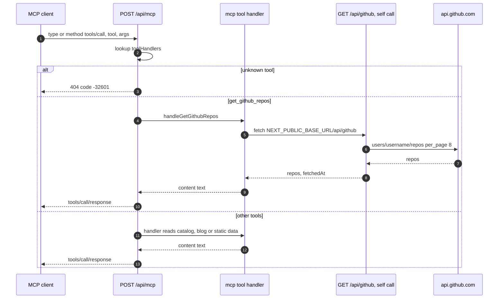

# 10 — Sequence diagrams

Status: **done**. 4 request path หลัก

## 1. Contact form → Resend → contact_sent

Sources: `src/components/contact-client.tsx`, `src/app/api/contact/route.ts`, `src/lib/server-analytics.ts`

## 2. Case study view + consent-gated events

Sources: `src/app/[locale]/projects/[slug]/project-detail-client.tsx`, `src/lib/browser-analytics.ts`, `src/lib/posthog-adapter.ts`

## 3. Screenshot proxy

Sources: `src/app/api/screenshot/route.ts`, `src/data/app-projects.ts`, `next.config.js` (`images.remotePatterns` api.microlink.io)

## 4. MCP tools/call

Sources: `src/app/api/mcp/route.ts`, `src/lib/mcp/tools/index.ts`, `src/lib/mcp/tools/get-github-repos.ts`, `src/app/api/github/route.ts`
