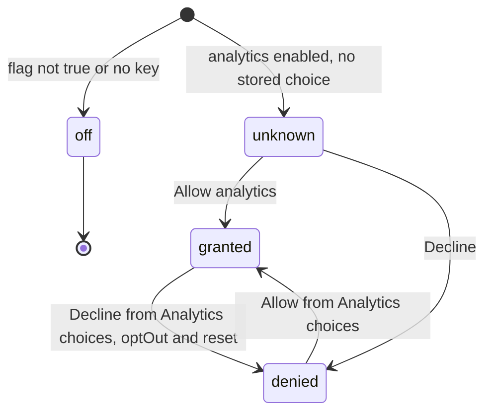
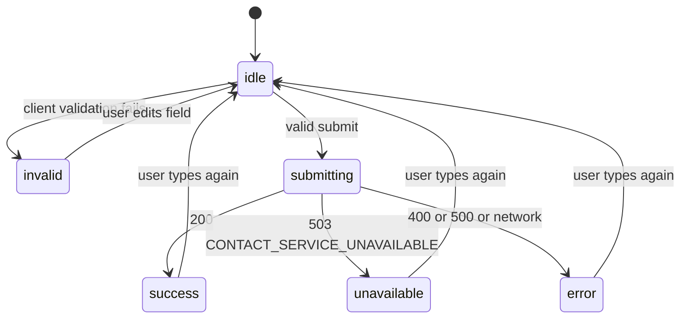
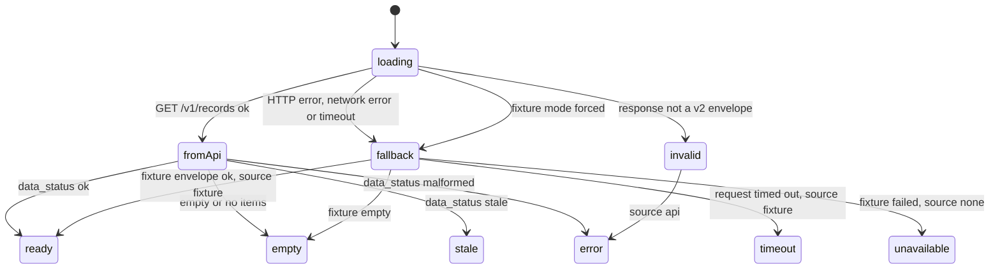
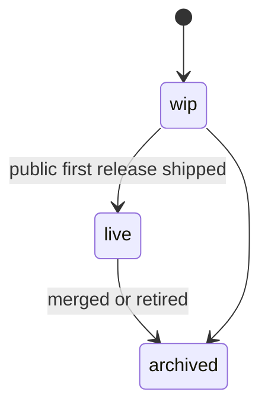
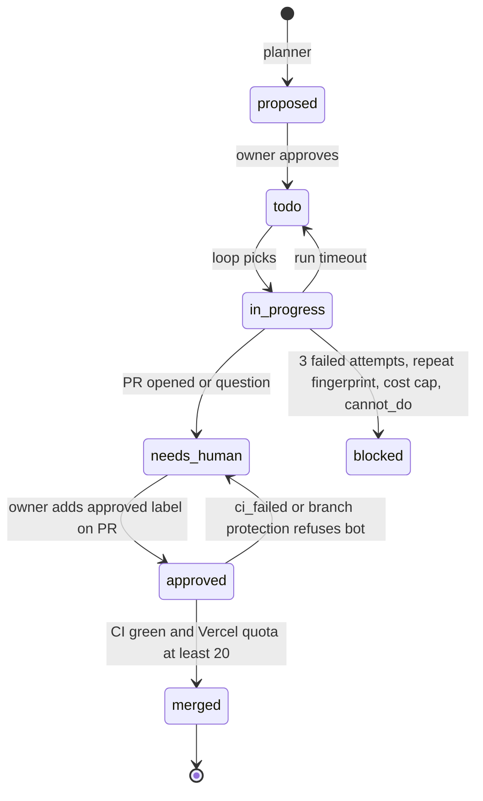

# 11 — State machines

Status: **done**. ไม่มี entity ใน DB; state ที่มี lifecycle จริงในโค้ดมี 5 ตัว

## Analytics consent (`Consent`)

Sources: `src/lib/browser-analytics.ts` (`readConsent`, `setConsent`), `src/components/analytics/consent-banner.tsx` (`panelState`)

## Contact form submit status

Sources: `src/components/contact-client.tsx` (`isSubmitting`, `submitStatus`), `src/app/api/contact/route.ts`

## Data-product load (`ConsumerLoadState`)

`fetchProductRecords` คืนผลครั้งเดียวต่อ product (ไม่มี transition ต่อหลังจากนั้น) จึงวาดเป็นทางเลือกของผลลัพธ์

Sources: `src/lib/data-products/types.ts`, `src/lib/data-products/client.ts` (`fetchProductRecords`, `stateFromEnvelope`), `src/lib/data-products/__tests__/client.contract.test.ts`

## Project card status (`ProjectStatus`)

Sources: `src/data/app-projects.ts` (`ProjectStatus`), `PRODUCT.md` ("WIP closure"), `src/app/[locale]/projects/[slug]/status-config.ts`.
การเปลี่ยน state ทำโดยแก้ไฟล์ด้วยมือ ไม่มีโค้ดบังคับ transition

## Autopilot issue labels

Sources: `.autopilot/README.md` (labels, เงื่อนไขหยุด), `.autopilot/config.json`, `.autopilot/tests/test_ci_gate.py`
