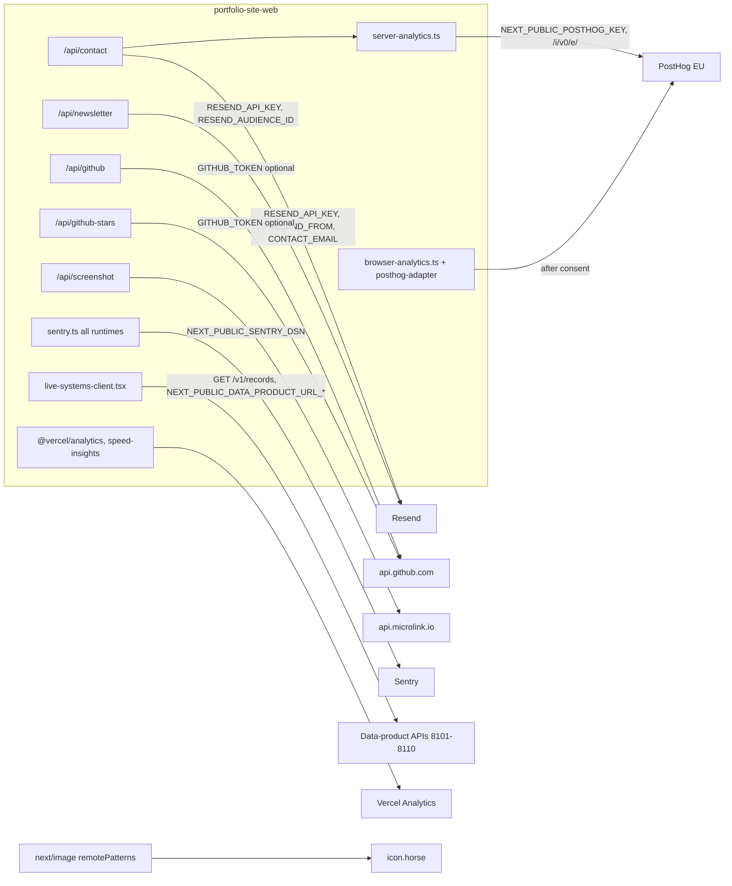

# 12 — API & integrations

Status: **done**

## Endpoints ของ repo นี้

| Method | Path | Runtime | Input | Output | Caller | External call |
|---|---|---|---|---|---|---|
| POST | `/api/contact` | Node (default) | JSON `name`, `email`, `subject`, `message`, `locale` | 200 / 400 `VALIDATION_ERROR` / 503 `CONTACT_SERVICE_UNAVAILABLE` / 500 | `contact-client.tsx` | Resend `emails.send`; PostHog capture (after) |
| POST | `/api/newsletter` | Edge | JSON `email` | 200 / 400 / 500 | `blog-client-wrapper.tsx` | Resend `POST /audiences/{RESEND_AUDIENCE_ID}/contacts` |
| GET | `/api/github` | Edge | — | `{repos[8], fetchedAt, username}` / 429 / 502 / 500 | MCP `get_github_repos` | GitHub `GET /users/{GITHUB_USERNAME}/repos` |
| GET | `/api/github-stars` | Node | — | `[{slug, repo, stars}]`, `[]` on error | `projects-client.tsx`, `project-detail-client.tsx` | GitHub `GET /users/{owner}/repos` per owner, ≤ 3 pages |
| GET | `/api/screenshot?url=` | Node, force-dynamic | demo URL in allowlist | 302 redirect / 400 | project cards `` | Microlink `GET /?url=&screenshot=true` |
| GET | `/api/search` | Node | — | blog post index JSON | `command-palette.tsx` | — |
| GET | `/api/mcp` | Node | — | server info + tools | MCP clients | — |
| POST | `/api/mcp` | Node | `type`/`method` = `initialize`, `tools/list`, `tools/call`, `ping` | MCP-style JSON | MCP clients, DevHub Playground | via tools (see below) |
| OPTIONS | `/api/mcp` | Node | — | 204 CORS | browsers | — |
| GET | `/sitemap.xml`, `/robots.txt`, `/manifest.webmanifest` | metadata routes | — | — | crawlers | — |
| GET | `/rss.xml`, `/rss-th.xml`, `/projects-rss.xml`, `/projects-rss-th.xml` | force-static, revalidate 3600 | — | RSS | readers | — |

MCP tools: `get_projects`, `get_skills`, `get_blog_posts`, `get_blog_post`, `get_github_repos`, `get_contact_info`

Sources: `src/app/api/*/route.ts`, `src/lib/mcp/tools/*.ts`, `src/app/sitemap.ts`, `src/app/robots.ts`, `src/app/manifest.ts`, `src/app/*rss*/route.ts`, `next.config.js` headers

## External integrations

Sources: ไฟล์ใน subgraph, `next.config.js` (`images.remotePatterns`), `README.md` "Environment Variables"

## Inbound webhooks

ไม่มี webhook รับเข้า — ไม่พบ route ที่รับ callback จากระบบภายนอก (GitHub `deployment_status` ถูกใช้โดย workflow ไม่ใช่ app)

## Gaps

- `/api/newsletter` เมื่อไม่ได้ตั้ง Resend audience จะตอบ `success: true` ("Newsletter feature is being configured") และ `console.log` อีเมล — ผู้ใช้เข้าใจว่าสมัครแล้วแต่ไม่มีการเก็บ
- `/api/github` และ `/api/mcp` คืน `details`/`String(err)` ของ error ให้ client
- ไม่มี rate limit ใน `/api/contact`, `/api/newsletter`, `/api/mcp`

## Open questions

- `RESEND_AUDIENCE_ID` ตั้งใน Vercel หรือไม่ (README ไม่ระบุตัวแปรนี้)
- `GITHUB_USERNAME`, `NEXT_PUBLIC_BASE_URL` ตั้งใน production หรือใช้ค่า default
