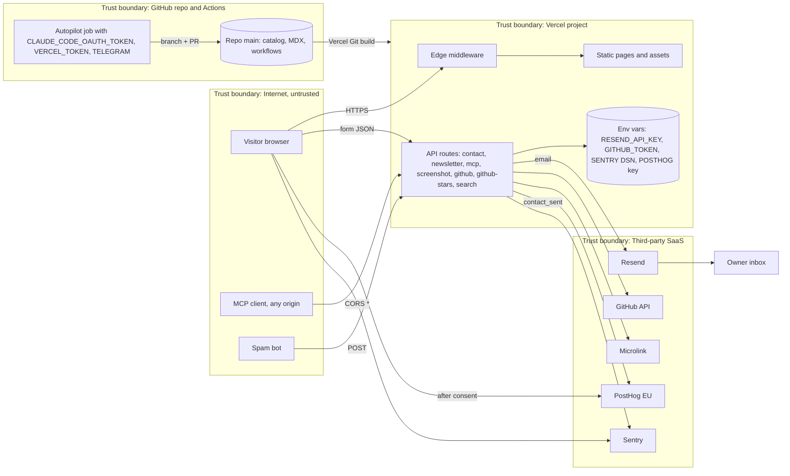

# 13 — Threat model (DFD + STRIDE)

Status: **done**. ไม่มี auth ไม่มี DB; ทรัพย์สินหลักคือ ความน่าเชื่อถือของ catalog, inbox เจ้าของ, API keys (Resend, GitHub, PostHog, Sentry, Vercel token ใน Actions), และความเป็นส่วนตัวของผู้มาเยือน

Sources: `src/app/api/*/route.ts`, `middleware.ts`, `next.config.js`, `src/lib/sentry.ts`, `src/lib/posthog-adapter.ts`, `.github/workflows/autopilot.yml`, `.github/workflows/ci.yml`, `vercel.json`

## STRIDE ต่อ element

| Element | Threat (STRIDE) | Mitigation ที่พบในโค้ด | Gap |
|---|---|---|---|
| `/api/contact` | **S** ปลอม sender / **T** HTML injection ในอีเมล | `escapeHtml` ทุกช่อง, subject ตัด `\r\n`, `replyTo` = sender, max length, email regex | ไม่มี CAPTCHA / honeypot |
| `/api/contact` | **D** spam, ใช้โควตา Resend | production ไม่ส่งถ้าไม่มี `RESEND_FROM` | ไม่มี rate limit ต่อ IP |
| `/api/newsletter` | **R/I** อีเมลลง log, ตอบ success ทั้งที่ไม่เก็บ | ตรวจ `@` อย่างง่าย | log `console.log('[Newsletter] New signup:', email)` เมื่อไม่ได้ตั้งค่า (อาจถูกตัดโดย `compiler.removeConsole` ใน production — ต้องยืนยัน); ไม่มี rate limit |
| `/api/screenshot` | **S/E** SSRF ผ่าน `url` | allowlist จาก `publicDemoUrl` + `https:` เท่านั้น | cache ใน memory ไม่จำกัด TTL ต่อ instance (ลบเหลือ 100) — ต่ำ |
| `/api/mcp` | **I** เปิดข้อมูล / **D** เรียกถี่ | ข้อมูลเป็น public (catalog, blog), source ที่ hidden ไม่หลุด (AC-03 test) | CORS `*`, ไม่มี auth/rate limit, error ส่ง `error.message` กลับ |
| `/api/github`, `/api/github-stars` | **D** GitHub rate limit, **I** token | token อยู่ฝั่ง server, cache 1 ชม. / `s-maxage`, 429 + `Retry-After` | `/api/github` คืน `details` และ `String(err)` |
| Static pages | **T** XSS ใน JSON-LD / MDX | JSON-LD จาก `JSON.stringify` ของข้อมูลใน repo; MDX มาจาก repo เท่านั้น | ไม่มี Content-Security-Policy header |
| HTTP headers | **T/I** clickjacking, sniffing | `X-Frame-Options: DENY`, `nosniff`, `Referrer-Policy`, `Permissions-Policy`, HSTS `includeSubDomains` | ไม่มี CSP |
| Browser analytics | **I** PII ไป PostHog | SDK โหลดหลัง consent, allow-list props, `before_send` scrub, no autocapture/recording | — (มี test) |
| Sentry | **I** PII ใน error | `scrubEvent`, no PII, no breadcrumbs/replay/tracing | Sentry region US (KPI-PLAN) — DPA ยังต้องยืนยัน |
| Env vars | **I** key รั่ว | `NEXT_PUBLIC_*` มีแค่ค่า public; `.env*` ใน `.gitignore`; gitleaks ใน `security.yml` | — |
| Repo / supply chain | **T** dependency ที่มีช่องโหว่ | `security.yml` (gitleaks, semgrep, osv-scanner, trivy-fs), action pin SHA, `osv-scanner.toml` exceptions มีวันหมดอายุ | — |
| Autopilot job | **E** AI agent push code / ใช้ secret | `persist-credentials: false`, token เฉพาะ step, PR-approval, `protected_paths`, quota gate | job มี `contents: write` + `actions: write` |
| Vercel deploy | **T** commit ที่ CI fail ขึ้น production | deploy-smoke หลัง deploy | CI ไม่ gate deploy ([ADR-0002](08-adr/ADR-0002-vercel-git-deploy-ci-not-gating.md)) |

Sources: ตามคอลัมน์ mitigation; `osv-scanner.toml`; `.gitignore`; platform-ci-workflows `security.yml` @ `87dc5e1` (jobs gitleaks, semgrep, osv-scanner, trivy-fs)

## Open questions

- `compiler.removeConsole` ใน `next.config.js` ลบ `console.*` ฝั่ง server ด้วยหรือไม่ (ถ้าใช่ log error ของ `/api/contact` จะหายไปด้วย)
- ต้องการ CSP / rate limit (เช่น Vercel Firewall) สำหรับ `/api/contact` และ `/api/mcp` หรือไม่
- Testimonials ใน `src/data/testimonials.ts` (เช่น "Sarah Chen, TechVenture Asia") เป็นคนจริงที่ยินยอมหรือเป็นตัวอย่าง — ถ้าไม่จริงขัดกับ SPEC-001 "claim only what ships"
