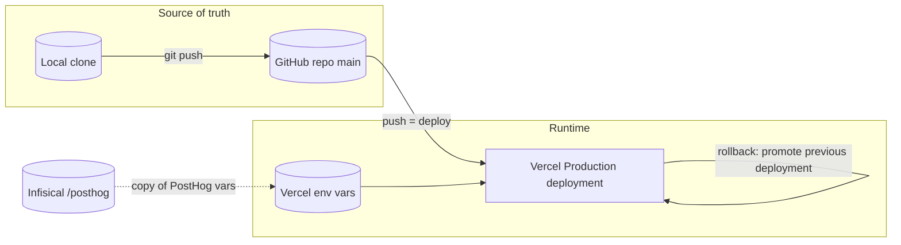

# 14 — Backup & disaster recovery

Status: **done**. ไม่มี database ([ADR-0003](08-adr/ADR-0003-file-based-content-no-database.md)) — DR = กู้ code + config + deployment

## Data inventory

| Data | อยู่ที่ไหน | Backup ที่มีจริง | Restore |
|---|---|---|---|
| Source, catalog, blog MDX, messages, fixtures | GitHub `bookchaowalit-website/portfolio-site-web` (public) + clone ในเครื่องเจ้าของ | Git history (distributed copies) | `git clone` + push / Vercel redeploy |
| Production build | Vercel deployments (78 Production deployments ใน 90 วัน) | Vercel เก็บ deployment เก่า | promote / redeploy deployment ก่อนหน้า (RUNBOOK "Rollback" ข้อ 1) |
| Env vars (Resend, GitHub token, PostHog, Sentry DSN) | Vercel project env; PostHog vars ใน Infisical `/posthog` ด้วย | Infisical สำหรับ PostHog (`docs/measurement/GO-LIVE.md` step 3) | ตั้งใหม่ใน Vercel แล้ว deploy (`NEXT_PUBLIC_*` inline ตอน build) |
| Contact messages | Owner inbox (`CONTACT_EMAIL`) ผ่าน Resend | ไม่มีใน repo — ขึ้นกับ mailbox provider | — |
| Newsletter contacts | Resend audience `RESEND_AUDIENCE_ID` | ไม่พบ | — |
| Product analytics | PostHog EU (retention รายงาน 1 ปี, ต้องยืนยัน) | — | ไม่ต้อง restore (aggregate) |
| Errors | Sentry `personal-yu0/portfolio-site-web` | — | — |
| Consent choice | localStorage ของผู้มาเยือน | — | ผู้มาเยือนเลือกใหม่ |
| Server caches (stars, screenshot) | memory ต่อ instance | ไม่ต้อง | สร้างใหม่อัตโนมัติ |

Sources: `RUNBOOK.md`, `docs/measurement/GO-LIVE.md`, `docs/measurement/KPI-PLAN.md` (retention, Sentry project), `src/app/api/contact/route.ts`, `src/app/api/newsletter/route.ts`, `.autopilot/README.md` (Vercel project)

## RTO / RPO

| | ค่า |
|---|---|
| RTO | **not defined** |
| RPO | **not defined** (code: last push to GitHub; ไม่มี data อื่นที่ระบบเป็นเจ้าของ) |
| Restore drill | ไม่พบ |

## Open questions

- ไม่มีขั้นตอน rollback ที่ทดสอบแล้วสำหรับ Vercel (`RUNBOOK.md` เป็น stub "Redeploy previous container image / previous git tag")
- env vars อื่นนอกจาก PostHog (`RESEND_*`, `GITHUB_TOKEN`, `NEXT_PUBLIC_SENTRY_DSN`) อยู่ใน Infisical ด้วยหรือไม่
- DNS ของ `bookchaowalit.com` อยู่ที่ใด และใครกู้ได้ (ไม่มีใน repo)
