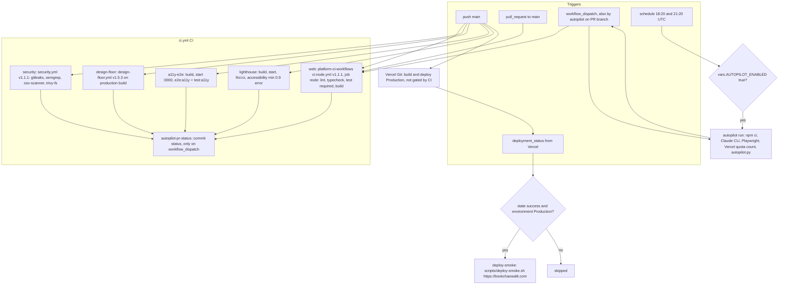

# 15 — CI/CD pipeline

Status: **done**. 3 workflows: `ci.yml`, `deploy-smoke.yml`, `autopilot.yml`; deploy ทำโดย Vercel Git ไม่ใช่ Actions

Sources: `.github/workflows/ci.yml`, `.github/workflows/deploy-smoke.yml`, `.github/workflows/autopilot.yml`, `scripts/deploy-smoke.sh`, `lighthouserc.ci.json`,
platform-ci-workflows `ci-node.yml`/`security.yml` @ `87dc5e1`, `design-floor.yml` @ `81b568f` (อ่านจาก clone `~/work/design-floor-r3/platform-ci-workflows`)

## Job details

| Workflow | Job | needs | Runner | สิ่งที่ตรวจ |
|---|---|---|---|---|
| ci.yml | `web` → `node (.)` | — | reusable | lint, typecheck, `npm test` (`require-tests: true`), `npm run build` |
| ci.yml | `security` | — | reusable | gitleaks, semgrep, osv-scanner (`osv-scanner.toml`), trivy-fs |
| ci.yml | `design-floor` | — | reusable | ADR-0007 12 rules, 5 widths; build มี `NEXT_PUBLIC_ANALYTICS_ENABLED=true` + placeholder key |
| ci.yml | `a11y-e2e` "A11y / keyboard e2e" | — | ubuntu-24.04, 25 min | `e2e/keyboard-help`, `home`, `navigation`, `locale-theme` + `a11y-axe` |
| ci.yml | `lighthouse` "Lighthouse (a11y gate)" | — | ubuntu-24.04, 30 min | `/en`, `/en/projects`, `/en/contact`, `/th`; a11y ≥ 0.9 error, อื่น warn |
| ci.yml | `autopilot-pr-status` | web, security, a11y-e2e, lighthouse, design-floor | ubuntu-24.04 | `if: always() && workflow_dispatch` → `gh api statuses` |
| deploy-smoke.yml | `deploy-smoke` | — | ubuntu-24.04, 10 min | 200 บน `/en`, `/th`, `/en/projects`, 3 project pages + ไม่มี legacy `bookchaowalit-<slug>-frontend` link |
| autopilot.yml | `run` | — | ubuntu-latest, 60 min | ดู [01](01-business-process.md) / [11](11-state-machines.md) |

## Observed (gh run list, ถึง 2026-11-03)

- `ci.yml` push บน main ตั้งแต่ 2026-08-05: 58 success, 7 failure, 4 cancelled
- `deploy-smoke.yml`: 23 success, 13 skipped (ไม่ใช่ Production success), 0 failure
- `autopilot.yml`: schedule 18 success / 2 failure, dispatch 4 success

## Open questions

- README "CI" ยังอธิบาย job `quality` แบบเก่า และ branch protection ยังต้องการ `Typecheck, lint, unit` ที่ไม่มีแล้ว (ดู [18](18-git-release-workflow.md))
- `npm run audit:links` ควรเป็น scheduled workflow หรือไม่ (KPI-G-01 cadence "monthly")
