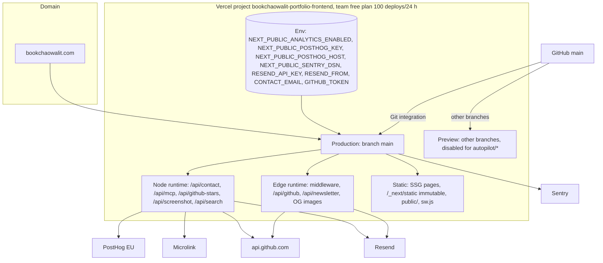

# 16 — Deployment

Status: **done**

Sources: `vercel.json`, `.autopilot/README.md` / `.autopilot/config.json` (`deploy.note`), `specs/001-truthful-portfolio/spec.md` §4 (Sentry DSN set as Vercel env 2026-10-21) และ §6,
`docs/measurement/GO-LIVE.md` (3 PostHog vars in Production 2026-10-26), `README.md` env table, `next.config.js` (headers, Serwist), `src/app/api/*/route.ts` runtimes

| Environment | Branch | URL | หลักฐาน |
|---|---|---|---|
| Production | `main` | https://bookchaowalit.com | `deploy-smoke.yml`, GitHub Deployments `Production` by `vercel[bot]` |
| Preview | branch อื่น (ยกเว้น `autopilot/*`) | Vercel preview URL | GitHub Deployments `Preview`, `vercel.json` |
| Local | — | `next dev --turbopack`; Playwright :4318; CI :3000 | `package.json`, `playwright.config.ts`, `ci.yml` |

## Open questions

- README "Other Platforms" อ้าง Docker แต่ repo ไม่มี `Dockerfile`
- Vercel region / function region ไม่ระบุใน repo
- domain alias อื่น (www, `*.vercel.app`) ไม่มีใน repo
