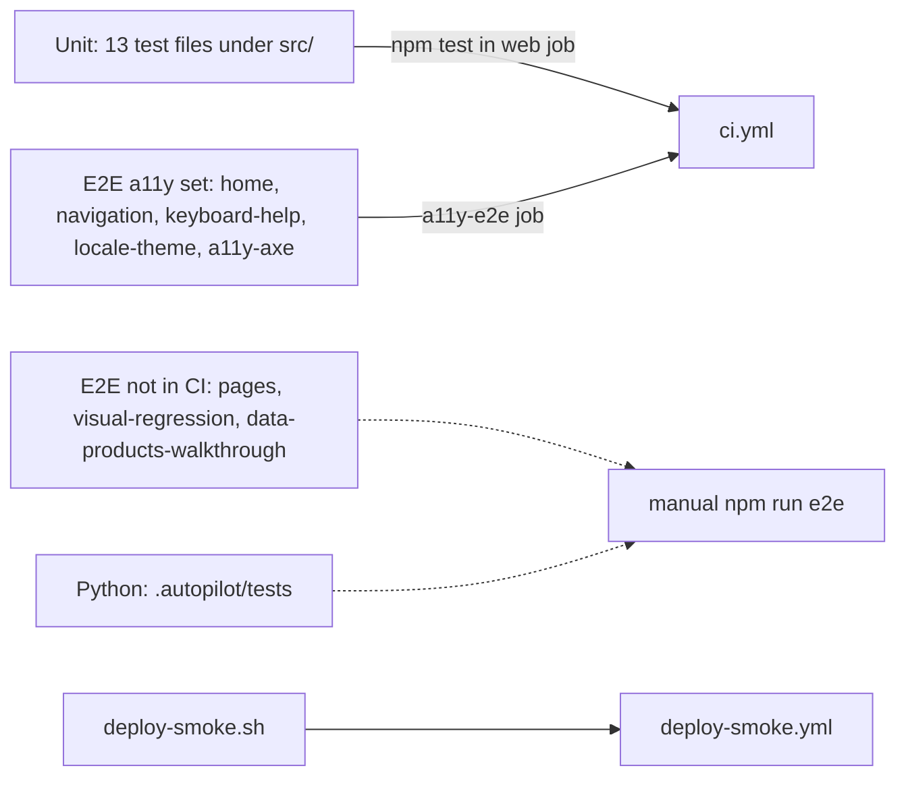

# 17 — Test coverage matrix

Status: **done**. Unit = `node --experimental-strip-types --test` (`npm test` = `test:data-products` + `test:portfolio` + `test:lib`);
E2E = Playwright (`e2e/`); ไม่มี integration test ที่ยิง API route จริง (ไม่มีไฟล์ test ใต้ `src/app/api/`)
"CI" = รันใน `ci.yml`

| Feature | Unit | Integration | E2E | In CI? |
|---|---|---|---|---|
| Catalog integrity, counts, domains | `src/data/__tests__/portfolio-catalog.test.ts` | — | `e2e/pages.spec.ts` (projects page) | unit ✅ / e2e ❌ |
| Source/demo links (SPEC-001 AC-01–03) | `src/data/__tests__/source-links.test.ts` | — | — (deploy-smoke checks legacy links on prod) | ✅ |
| Card claims (AC-04) | `portfolio-catalog.test.ts` "portfolio claims" | — | — | ✅ |
| Stars (AC-05) | `src/data/__tests__/project-stars.test.ts` | — | — | ✅ |
| Sentry scrub (AC-06) | `src/lib/__tests__/sentry.test.ts` | — | — | ✅ |
| Browser analytics + consent | `browser-analytics.test.ts`, `consent-banner.test.ts` | — | — | ✅ |
| PostHog adapter | `posthog-adapter.test.ts` | — | — | ✅ |
| Server analytics `contact_sent` | `server-analytics.test.ts` | — | — | ✅ |
| Event catalog ↔ docs | `event-catalog.test.ts` | — | — | ✅ |
| GA4 removed | `no-ga4.test.ts` | — | — | ✅ |
| Fonts / design floor | `font-variables.test.ts` | — | design-floor job | ✅ |
| Data-product client contract | `client.contract.test.ts`, `contract.freeze.test.ts` | — | `e2e/data-products-walkthrough.spec.ts` | unit ✅ / e2e ❌ |
| Home sections, skip link | — | — | `e2e/home.spec.ts` | ✅ (a11y-e2e) |
| Navigation desktop + mobile | — | — | `e2e/navigation.spec.ts` | ✅ |
| Help dialog keyboard | — | — | `e2e/keyboard-help.spec.ts` | ✅ |
| Locale, theme, JSON-LD | — | — | `e2e/locale-theme.spec.ts` | ✅ |
| Axe a11y (5 routes) | — | — | `e2e/a11y-axe.spec.ts` | ✅ (`test:a11y`) |
| Lighthouse a11y ≥ 0.9 (4 routes) | — | — | `lighthouserc.ci.json` | ✅ |
| Contact form labels | — | — | `e2e/pages.spec.ts` | ❌ |
| **Contact API validation / 503 / Resend** | **gap** | **gap** | **gap** (labels only) | — |
| **Newsletter API** | **gap** | **gap** | **gap** | — |
| **MCP endpoint** | **gap** (`scripts/test-mcp.mjs` manual; `mcp:test` script points to missing `test-mithub.mjs`) | **gap** | — | — |
| **Screenshot allowlist** | indirect (`publicDemoUrl` tests) | **gap** | — | — |
| Blog pages, RSS, sitemap | — | — | `e2e/pages.spec.ts` (blog loads) | ❌ |
| Visual regression (5 pages × 3 viewports + dark) | — | — | `e2e/visual-regression.spec.ts` + snapshots | ❌ |
| Production smoke | — | — | `scripts/deploy-smoke.sh` | ✅ (deploy-smoke.yml) |
| Autopilot CI gate / ledger | `.autopilot/tests/test_ci_gate.py`, `test_ledger.py` | — | — | ❌ (not in ci.yml) |

Sources: `package.json` scripts, `src/**/__tests__/*.test.ts`, `e2e/*.spec.ts`, `.github/workflows/ci.yml`, `lighthouserc.ci.json`, `.autopilot/tests/*`, `scripts/`

## Coverage %

ไม่มีการวัด coverage (`ci-node.yml` v1.1.1 มี input `coverage-threshold` แบบ opt-in แต่ `ci.yml` ไม่ได้ส่งค่า) — **not measured**

## Open questions

- `package.json` `mcp:test` → `scripts/test-mithub.mjs` และ `mcp:dev` → `scripts/test-github.mjs` ไม่มีไฟล์จริง (มี `scripts/test-mcp.mjs`, `scripts/check-github.mjs`) — script เสีย
