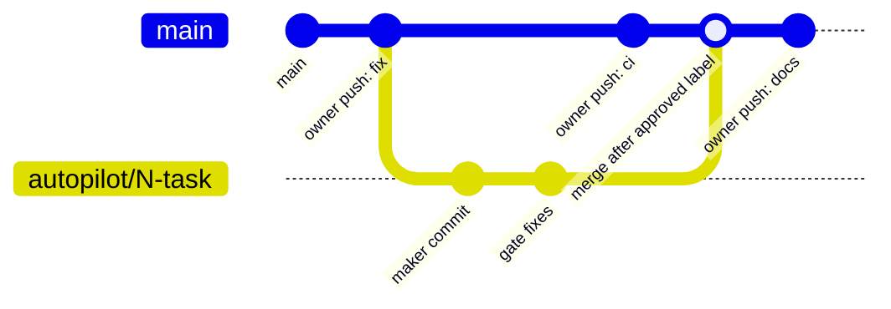
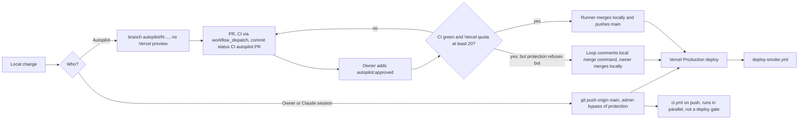

# 18 — Git & release workflow

Status: **done**. Trunk-based: `main` = production; ส่วนใหญ่เจ้าของ push ตรงเข้า `main` (90 วันล่าสุดมี merge commit บน first-parent แค่ 2 ตัว) งาน autopilot มาเป็น PR

Sources: `.autopilot/README.md`, `.autopilot/config.json` (`merge`), `.github/workflows/autopilot.yml`, `.github/workflows/ci.yml`, `vercel.json`,
`git log origin/main --since="90 days ago" --merges --first-parent --oneline | wc -l` → 2

## Branch protection (live, `gh api repos/bookchaowalit-website/portfolio-site-web/branches/main/protection`)

Required checks: `Typecheck, lint, unit`, `A11y / keyboard e2e`, `Lighthouse (a11y gate)` (strict).
`Typecheck, lint, unit` ไม่มี job ชื่อนี้แล้ว (ตอนนี้เป็น `web / node (.)`) จึงไม่มี PR ไหนผ่าน protection ได้โดยไม่มี admin bypass — ตรงกับ `.autopilot/README.md`

## Versioning / tags

ไม่พบ tag/release process; `package.json` version `0.1.0` คงที่ — release = commit บน `main`

## Open questions

- ต้องการอัปเดต required check เป็น `web / node (.)` เพื่อให้ bot merge ได้หรือไม่ (การตัดสินใจของเจ้าของตาม README autopilot)
- ต้องการ tag/CHANGELOG หรือไม่
