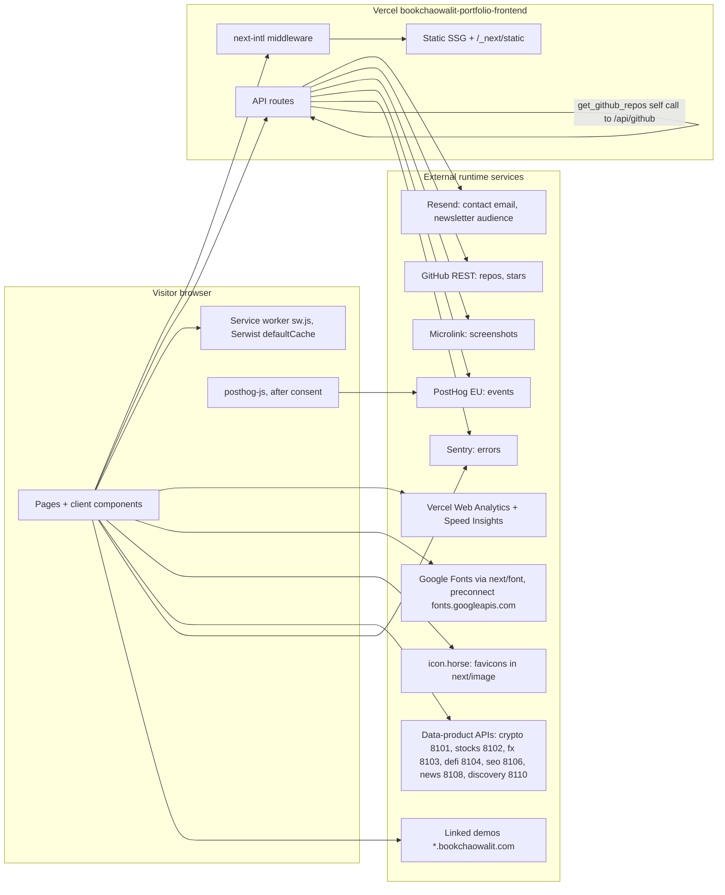

# 19 — Service dependency map (runtime)

Status: **done**

Sources: `src/app/[locale]/layout.tsx` (fonts, preconnect, Vercel Analytics), `src/app/layout.tsx` (SpeedInsights), `src/app/sw.ts`, `next.config.js` (Serwist, images.remotePatterns),
`src/app/api/*/route.ts`, `src/lib/data-products/catalog.ts`, `src/lib/mcp/tools/get-github-repos.ts`, `src/lib/sentry.ts`, `src/lib/posthog-adapter.ts`

## Criticality

| Dependency | ถ้าล่ม | Degradation ในโค้ด |
|---|---|---|
| Vercel | เว็บล่มทั้งหมด | — |
| Resend | contact ส่งไม่ได้ | 500 "Failed to send message"; ถ้าไม่ได้ตั้งค่า 503 + direct email |
| GitHub API | ไม่มี stars / repos | `/api/github-stars` คืน `[]`; `/api/github` 429/502 |
| Microlink | ไม่มี screenshot | redirect ไป placeholder SVG |
| PostHog | ไม่มี events | SDK load fail ถูกกลืน; server event timeout 2 s แล้ว `console.warn` |
| Sentry | ไม่มี error report | ปิดเองถ้าไม่มี DSN |
| Data-product APIs | Live Systems ใช้ fixtures | fixture fallback ใน `client.ts` |

## Open questions

- `scraper-dashboard.json` และ `data-products-fallback.json` ใน `public/data/` ยังมีผู้อ่านหรือไม่ (SW exclude ตัวแรกไว้ว่า deprecated)
