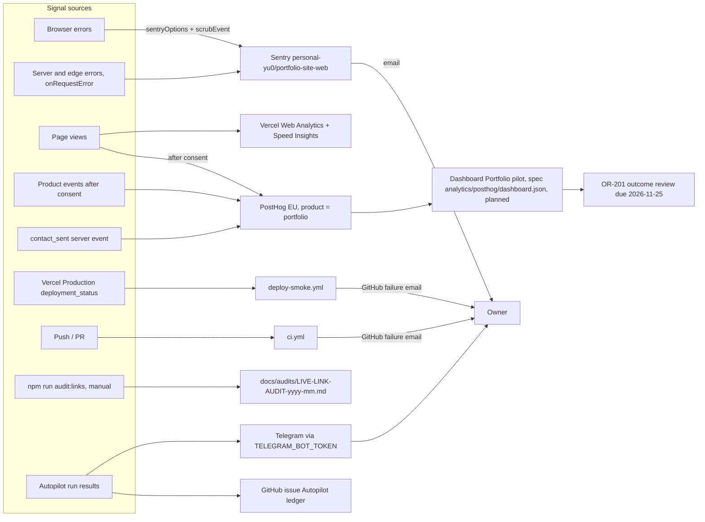

# 20 — Observability

Status: **done**. Signal ที่มีจริงใน repo; ไม่มี log drain, uptime check หรือ heartbeat ใน repo นี้

Sources: `src/lib/sentry.ts`, `instrumentation-client.ts`, `src/instrumentation.ts`, `src/app/layout.tsx`, `src/app/[locale]/layout.tsx`, `src/lib/posthog-adapter.ts`,
`src/lib/server-analytics.ts`, `.github/workflows/deploy-smoke.yml`, `.github/workflows/ci.yml`, `.github/workflows/autopilot.yml`, `.autopilot/config.json` (`notify`, `ledger_issue_title`),
`docs/measurement/KPI-PLAN.md` "Dashboards and alerts", `analytics/posthog/dashboard.json`, `docs/measurement/GO-LIVE.md`

## What is watched

| Signal | KPI | Alert | Status (KPI-PLAN / GO-LIVE) |
|---|---|---|---|
| Deploy smoke | KPI-G-01 | GitHub failure email | live |
| Catalog claims tests | KPI-G-02 | GitHub failure email (CI) | live |
| Sentry errors | KPI-G-03 (≤ 5/week, alert > 20/day) | Sentry email | DSN set 2026-10-21 |
| `contact_sent` | KPI-O-01 | 0 for 30 days → review | events live 2026-10-26; delivery needs `RESEND_FROM` |
| `view_project`, `click_*` | KPI-L-01, KPI-L-02 | read at weekly review | live, dashboard planned (GO-LIVE step 6) |
| Autopilot | — | Telegram events `task_done`, `task_blocked`, `needs_human`, `pr_opened`, `budget_hit`, `paused`, `rate_limited`, `proposals`, `run_error` | active |

## Not instrumented

- Logs: `console.*` ใน API routes เท่านั้น และ `next.config.js` `compiler.removeConsole` = true ใน production — อาจไม่มี log เลย (ต้องยืนยัน)
- Tracing / performance: ปิดใน Sentry (`tracesSampleRate: undefined`); มีแค่ Speed Insights
- Uptime / synthetic นอกจาก deploy-smoke: ไม่มีใน repo

## Open questions

- bookchaowalit.com อยู่ใน uptime monitor กลางของ Solo Empire หรือไม่ (ไม่มีใน repo นี้)
- Sentry alert rule (> 20 errors/วัน) ตั้งใน Sentry แล้วหรือยัง
