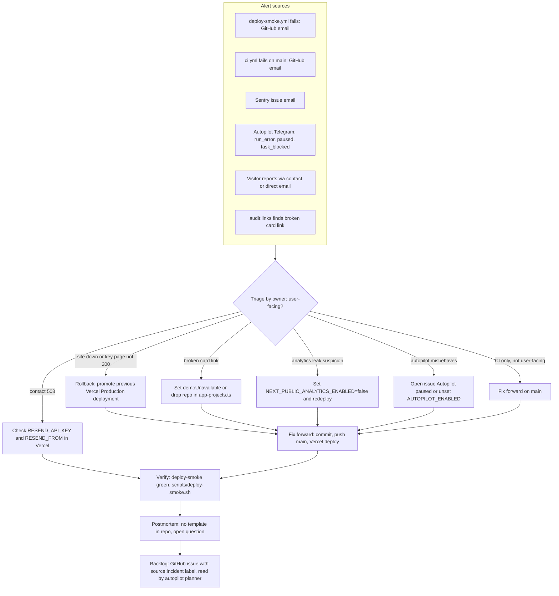

# 21 — Incident response

Status: **done** (ใช้ช่องทางแจ้งเตือนที่พบจริง; ไม่มี on-call — `RUNBOOK.md` "Solo operator, no multi-person on-call")

Sources: `.github/workflows/deploy-smoke.yml`, `.github/workflows/ci.yml`, `docs/measurement/KPI-PLAN.md` (alert channels), `.autopilot/config.json` (`notify.events`),
`.autopilot/README.md` (planner reads `source:incident`; pause issue), `.github/workflows/autopilot.yml` (`vars.AUTOPILOT_ENABLED`), `docs/measurement/GO-LIVE.md` ("Turning it off again"),
`RUNBOOK.md` (Rollback), `src/app/api/contact/route.ts`, `scripts/live-link-audit.mjs`

## Severity (เสนอจากสิ่งที่มี ไม่ได้กำหนดไว้ใน repo)

ไม่พบ severity matrix หรือ SLA ใน repo — **not defined**

## Open questions

- ต้องการ postmortem template (เช่นจาก architecture-docs) และที่เก็บ (`docs/incidents/`) หรือไม่
- ขั้นตอน rollback ใน Vercel ยังไม่มีเอกสารที่ทดสอบแล้ว
