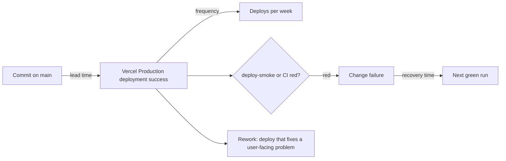

# 22 — DORA metrics

Status: **done** (4 ค่าคำนวณได้ด้วย proxy, 1 ค่า proxy อย่างเดียว). Window: 90 วันถึง 2026-11-03 (since 2026-08-05T07:00Z)
Deploy = GitHub Deployment `environment=Production` ที่ `vercel[bot]` สร้าง (Vercel Git integration)



Sources: `.github/workflows/deploy-smoke.yml`, `.github/workflows/ci.yml`, GitHub Deployments / Actions API

## Results

| Metric | วิธีวัดใน repo นี้ | ค่า 90 วัน | หมายเหตุ |
|---|---|---|---|
| Deployment frequency | จำนวน Production deployments success | **78 deploys** (20 วันที่ต่างกัน) ≈ **6.1 / week**; ส.ค. 47, ก.ย. 2, ต.ค. 22, พ.ย. (1–3) 7 | ทั้ง 78 มี status ล่าสุด `success` |
| Lead time for changes | committer time ของ SHA → เวลาของ deployment status `success` | median **2.5 min**, p90 **13.7 min**, max 255.5 min (n = 78) | committer date ≠ push time (rebase/amend รีเซ็ต) — ค่าเป็น lower bound |
| Change fail rate | (a) deploy-smoke failures / smoke-checked deploys; (b) deployed SHAs ที่ `ci.yml` บน main = failure | (a) **0 / 22** (smoke เริ่ม 2026-10-21); (b) **7 / 78 = 9.0%** | (b) เป็น CI failure ไม่ใช่ incident ที่ผู้ใช้เห็นเสมอ (เช่น เพิ่ม workflow ใหม่) แต่ทั้ง 7 commit ขึ้น production จริง |
| Failed deployment recovery time | เวลาจาก CI run แรกที่แดงบน main ถึง run ถัดไปที่เขียว | median **0.12 h (~7 min)**, 5 episodes: 0.03, 0.11, 0.56, 0.12, 0.44 h | ไม่มี smoke failure ให้วัด recovery ของ production จริง |
| Deployment rework rate | deploy ที่ทำเพื่อแก้ปัญหาที่ผู้ใช้เห็น | **cannot compute exactly** — proxy: deploy ที่ subject ขึ้นต้น `fix`/`revert`/`hotfix` = **29 / 78 (37%)**; revert = 0 | ไม่มี incident label / postmortem ให้แยก fix ที่วางแผนไว้กับ fix จาก incident |

## Commands

```bash
R=bookchaowalit-website/portfolio-site-web
SINCE=$(date -u -d '90 days ago' +%Y-%m-%dT%H:%M:%SZ)

# Production deployments in window (id, sha, created)
gh api "repos/$R/deployments?environment=Production&per_page=100" --paginate \
  --jq '.[] | [.id, .sha[0:7], .created_at] | @tsv' | awk -v s="$SINCE" '$3>=s' > deps.tsv

# Latest status + commit time per deployment (lead time = status time - committer time)
while IFS=$'\t' read id sha created; do
  st=$(gh api "repos/$R/deployments/$id/statuses?per_page=1" --jq '.[0] | [.state, .created_at] | @tsv')
  printf "%s\t%s\t%s\t%s\n" "$id" "$sha" "$st" "$(git show -s --format=%cI $sha)"
done < deps.tsv > depstat.tsv

# Smoke results and CI on main
gh run list -R $R --workflow deploy-smoke.yml --limit 200 --json conclusion --jq '.[].conclusion' | sort | uniq -c
gh run list -R $R --workflow ci.yml --branch main --event push --created ">=2026-08-05" --limit 300 \
  --json conclusion,createdAt,headSha --jq '.[] | [.conclusion,.createdAt,.headSha[0:7]] | @tsv' > ci.tsv

# Deployed SHAs whose CI failed
comm -12 <(grep failure ci.tsv | cut -f3 | sort -u) <(cut -f2 depstat.tsv | sort -u) | wc -l

# Rework proxy
for s in $(cut -f2 depstat.tsv); do git show -s --format=%s $s; done | grep -ciE '^(fix|revert|hotfix)'
```

ตัวเลข median/p90 และ recovery คำนวณด้วย Python เล็ก ๆ บน `depstat.tsv` / `ci.tsv` (ลำดับตามเวลา, จับคู่ failure แรกกับ success ถัดไป)

## Open questions

- ต้องการให้ CI gate deploy (เช่น Vercel "wait for checks") เพื่อให้ change fail rate (b) เป็น 0 หรือไม่
- ต้องการ label `incident` บน issue/commit เพื่อวัด rework rate ได้ตรงหรือไม่
